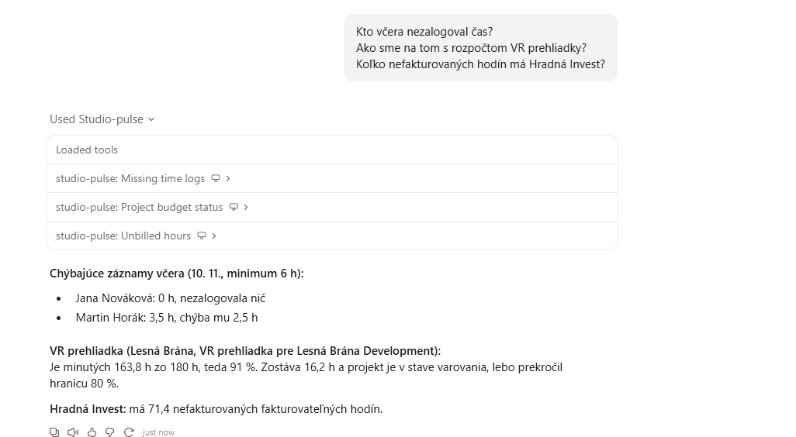
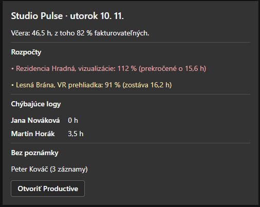
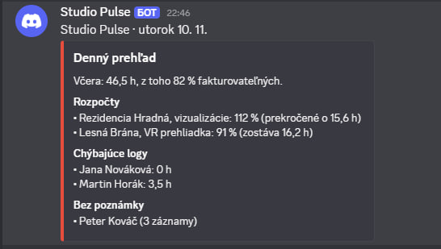

# Studio Pulse

[](https://github.com/DmytroLyvytskyi/studio-pulse/actions/workflows/ci.yml)

Time tracking and budget insights from [Productive](https://productive.io) for the project managers of a creative agency (3D visualizations, VR tours, web, CGI).

Project managers usually piece together the daily picture by hand: who forgot to log time, which project is about to blow its budget, how much billable work has not been invoiced yet. Studio Pulse gives them two things:

1. **An MCP server** that lets Claude answer questions such as *"Who didn't log their time yesterday?"*, *"How is the budget of the VR tour project doing?"* or *"How many billable hours of Hradná Invest are not invoiced yet?"*.
2. **A daily report** posted every working morning to Microsoft Teams and/or Discord: hours logged on the previous working day, billable ratio, projects close to or over budget, people with missing time logs and entries without a note.

Studio Pulse is read only: it never writes to Productive. The report text is in Slovak.

## Screenshots

Claude Desktop answering three questions with the MCP tools:



The daily report as an Adaptive Card in Microsoft Teams, and in Discord:

<p>
  
  
</p>

## Quick start (mock data)

Requires [uv](https://docs.astral.sh/uv/getting-started/installation/). uv installs Python 3.12 automatically. No accounts or tokens are needed: the default `DATA_SOURCE=mock` reads fictional data from `mock/`.

```bash
git clone https://github.com/DmytroLyvytskyi/studio-pulse.git
cd studio-pulse
uv sync
uv run studio-pulse report --dry-run
```

Example output:

```text
Studio Pulse · streda 11. 11.

Včera: 46,5 h, z toho 82 % fakturovateľných.

Rozpočty
• Rezidencia Hradná, vizualizácie: 112 % (prekročené o 15,6 h)
• Lesná Brána, VR prehliadka: 91 % (zostáva 16,2 h)

Chýbajúce logy
• Jana Nováková: 0 h
• Martin Horák: 3,5 h

Bez poznámky: Peter Kováč (3 záznamy)
```

Mock entries are stored relative to today, so the previous working day always contains these problem scenarios. Regenerate the data with `uv run python scripts/generate_mock.py` (fixed seed).

More report options:

```bash
uv run studio-pulse report --date 2026-11-09          # a specific day (also: today, yesterday)
uv run studio-pulse report --dry-run --show-payload   # also print the Teams and Discord JSON
uv run studio-pulse report --channel discord          # send to one channel only
uv run studio-pulse report                            # send to every configured channel
```

Without `--dry-run`, at least one webhook (below) must be configured.

## Claude Desktop setup

1. Run `uv sync` in the repository (see Quick start).
2. In Claude Desktop open **Settings → Developer → Edit Config**. This opens `claude_desktop_config.json`:
   - Windows: `%APPDATA%\Claude\claude_desktop_config.json`
   - macOS: `~/Library/Application Support/Claude/claude_desktop_config.json`
3. Add the server, with the absolute path to your clone.

   **macOS:**

   ```json
   {
     "mcpServers": {
       "studio-pulse": {
         "command": "uv",
         "args": ["--directory", "/Users/you/studio-pulse", "run", "studio-pulse-mcp"],
         "env": { "DATA_SOURCE": "mock" }
       }
     }
   }
   ```

   **Windows** (backslashes doubled in JSON):

   ```json
   {
     "mcpServers": {
       "studio-pulse": {
         "command": "uv",
         "args": ["--directory", "C:\\Users\\you\\studio-pulse", "run", "studio-pulse-mcp"],
         "env": { "DATA_SOURCE": "mock" }
       }
     }
   }
   ```

4. Quit Claude Desktop completely (also from the menu bar / system tray) and start it again. The `studio-pulse` tools appear in the tools menu.

If Claude Desktop reports that `uv` cannot be found, use its full path as `command` (`which uv` on macOS, `where.exe uv` in Windows PowerShell).

The server can also be inspected without Claude, with [MCP Inspector](https://github.com/modelcontextprotocol/inspector) (requires Node.js): `npx @modelcontextprotocol/inspector uv run studio-pulse-mcp`.

### MCP tools

All tools are read only. Person, project and client names match case-insensitively by any part of the name; dates accept `YYYY-MM-DD`, `today` or `yesterday`.

| Tool | Answers |
| --- | --- |
| `list_projects` | Which projects do we have for a client? |
| `get_time_entries` | What did Peter work on yesterday? |
| `missing_time_logs` | Who didn't log their time yesterday? (defaults to the previous working day) |
| `project_budget_status` | How is the budget of the VR tour project doing? |
| `hours_summary` | How many hours did we log per project, person or client last week? |
| `unbilled_hours` | How many billable hours of a client are not invoiced yet? |

## Delivery channels

A channel is enabled when its webhook URL is set, locally in `.env` (copy `.env.example`) or as a GitHub Actions secret. Webhook URLs are secrets: anyone with the URL can post to the channel.

### Discord

1. In Discord open **Server Settings → Integrations → Webhooks → New Webhook**.
2. Choose the channel, optionally rename it to "Studio Pulse", and click **Copy Webhook URL**.
3. Set `DISCORD_WEBHOOK_URL=<url>` and test with `uv run studio-pulse report --channel discord`.

### Microsoft Teams (Workflows)

Requires a **paid Microsoft 365 / Teams plan** and a **standard** (not private) channel. The report uses a Workflows webhook with an Adaptive Card 1.4. The older Office 365 Connectors incoming webhooks are retired and are not supported.

1. In Teams, open the channel's **⋯** menu → **Workflows**.
2. Pick the template **Post to a channel when a webhook request is received**, select the team and channel, and finish the wizard.
3. Copy the URL the wizard shows.
4. Set `TEAMS_WEBHOOK_URL=<url>` and test with `uv run studio-pulse report --channel teams`.

To check the card without sending it, run `uv run studio-pulse report --dry-run --show-payload` and paste the card's `content` object into the [Adaptive Cards Designer](https://adaptivecards.microsoft.com/designer).

### GitHub Actions

Two workflows live in `.github/workflows/`:

- `ci.yml` runs lint, format check and tests on every push and pull request.
- `daily-report.yml` runs `studio-pulse report` at 07:30 UTC on weekdays and can be started manually (**Actions → Daily report → Run workflow**).

In the repository open **Settings → Secrets and variables → Actions** and add:

| Name | Kind | Purpose |
| --- | --- | --- |
| `DISCORD_WEBHOOK_URL` | Secret | Discord channel (optional) |
| `TEAMS_WEBHOOK_URL` | Secret | Teams channel (optional) |
| `PRODUCTIVE_API_TOKEN` | Secret | Productive API token (for `DATA_SOURCE=productive`) |
| `PRODUCTIVE_ORG_ID` | Secret | Productive organization id (for `DATA_SOURCE=productive`) |
| `DATA_SOURCE` | Variable | `mock` (default when unset) or `productive` |

Set at least one webhook secret, otherwise the scheduled run fails with "No delivery channel is configured".

## Configuration

| File | Contents |
| --- | --- |
| `.env` (not committed) | `DATA_SOURCE`, `PRODUCTIVE_API_TOKEN`, `PRODUCTIVE_ORG_ID`, `TEAMS_WEBHOOK_URL`, `DISCORD_WEBHOOK_URL`. Environment variables override `.env`. |
| `config.yaml` | Thresholds, see below. |

```yaml
min_hours_per_day: 6          # less than this on a day counts as a missing time log
budget_warning_percent: 80    # budget status "warning" from this percent up to 100 %
low_billable_percent: 70      # the report flags a billable ratio below this
timezone: Europe/Bratislava   # defines "today" and the previous working day
```

Budget status: `ok` below the warning percent, `warning` from the warning percent up to 100 %, `over` above 100 %, `no_budget` when the project has no budget. The previous working day is Friday on Monday, Saturday and Sunday, otherwise the day before.

## Architecture

```text
                 ┌─────────────────────────┐
                 │ DataSource (Protocol)    │
                 │   mock    │  productive  │
                 └────────────┬────────────┘
                              │ models (Pydantic)
                              ▼
                 ┌─────────────────────────┐
                 │ analyze.py               │  pure functions, no I/O
                 └──────┬───────────┬──────┘
                        │           │
                        ▼           ▼
          ┌──────────────────┐  ┌──────────────────────┐
          │ mcp_server.py     │  │ report.py (CLI)       │
          │ FastMCP, stdio    │  │ ReportData            │
          │ client: Claude    │  │ → delivery adapters   │
          └──────────────────┘  │   console/teams/discord│
                                 └──────────────────────┘
```

**Numbers are computed by code, not by an LLM.** Every sum, percentage and threshold lives in plain, unit-tested Python in `analyze.py`, and each number is computed in exactly one place. The MCP server and the daily report call the same functions, so Claude and the morning report always show the same figures. Claude only picks a tool and phrases the answer; the project itself never calls an LLM.

Key modules in `src/studio_pulse/`:

- `sources/`: the `DataSource` interface (`people`, `projects`, `budgets`, `time_entries`), the mock implementation and the Productive implementation (`productive.py`, a read-only JSON:API client holding all response mapping). In Productive a time entry belongs to a service, the service to a budget (a deal with `budget: true`) and the budget to a project; a project's time budget is the sum of its services' budgeted time.
- `analyze.py`: missing logs, budget status, hours summaries, billable ratio, unbilled hours, the report data.
- `mcp_server.py`: the six MCP tools, thin wrappers around `analyze.py`.
- `report.py` and `delivery/`: the CLI and the console, Teams and Discord adapters.

Durations are stored in minutes and rounded to 0.1 h only for output.

## Known limitations

- **Drafts count as logged time.** Productive time entries count whether or not they are drafts, submitted or approved: for a project manager a draft still means the person logged the hours, so "missing logs" flags people who logged nothing, not people who have not submitted their timesheet. Unsubmitted time can still change.
- **Productive has no project kind.** Projects marked internal in Productive show as `INTERNAL`; every other Productive project shows as `OTHER` instead of 3D, VR, WEB or CGI.
- **Time off is not counted.** Productive time off entries belong to no project, so they are skipped, and a person on leave appears in "missing logs".
- **Only hour-based budgets.** A project's budget counts services tracked in hours; services tracked in days or pieces add no limit, and a budget without any hour limit shows as `no_budget`.
- **Archived projects stay listed as inactive.** Their history still counts, so a project archived in Productive keeps its hours in summaries and budgets.
- **Public holidays are ignored.** On a holiday the report still runs, and the day after a holiday reports the holiday itself, so everybody appears in "missing logs".
- **The cron shifts with summer time.** GitHub Actions cron runs in UTC: 07:30 UTC is 08:30 in Bratislava in winter (CET) but 09:30 in summer (CEST). Change the cron in `daily-report.yml` twice a year if the exact time matters. Scheduled runs can also start several minutes late.
- Budget usage and unbilled hours are computed from all time entries (the same rules for both sources) rather than taken from Productive's own budget totals.

Planned: a Claude skill for project managers and a static budget dashboard.

## Development

```bash
uv sync                       # install dependencies
uv run pytest                 # tests (no test makes a network call)
uv run ruff check .           # lint
uv run ruff format --check .  # format check
```

Studio Pulse is built with [Claude Code](https://claude.com/claude-code). [`CLAUDE.md`](CLAUDE.md) holds the rules the coding agent follows: principles, tech stack, domain rules, testing and code conventions. The work is done in small milestones, and every change is reviewed and tested (pytest, ruff) before it is committed.
